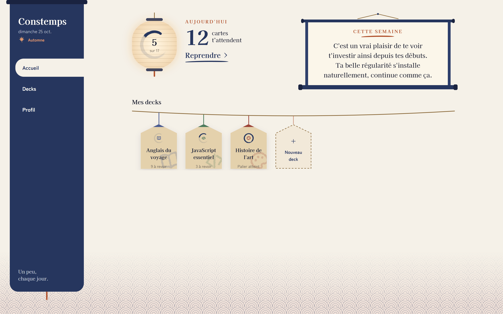
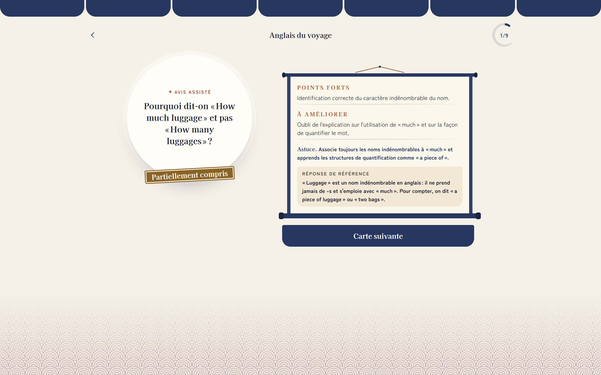
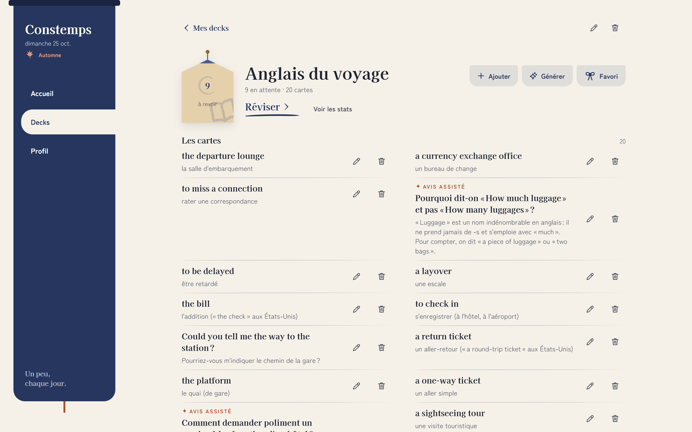
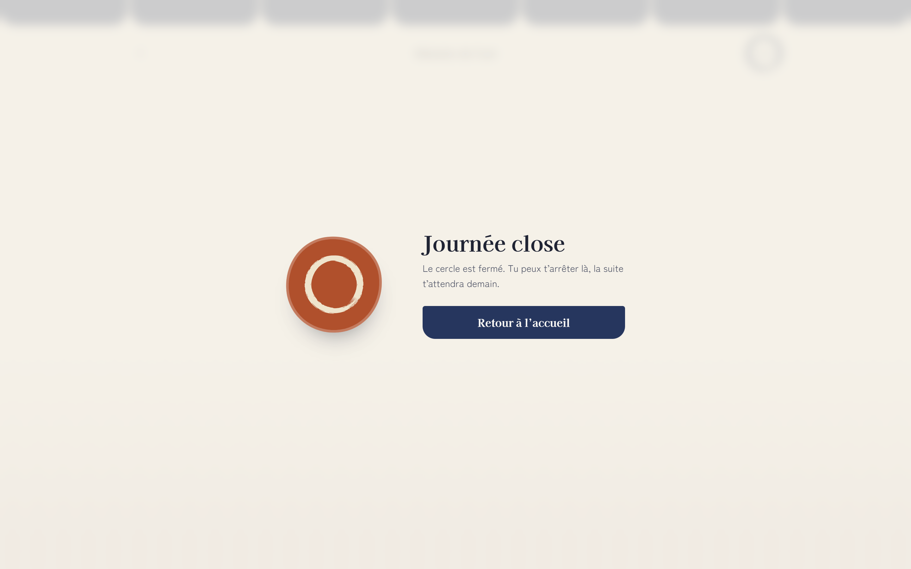
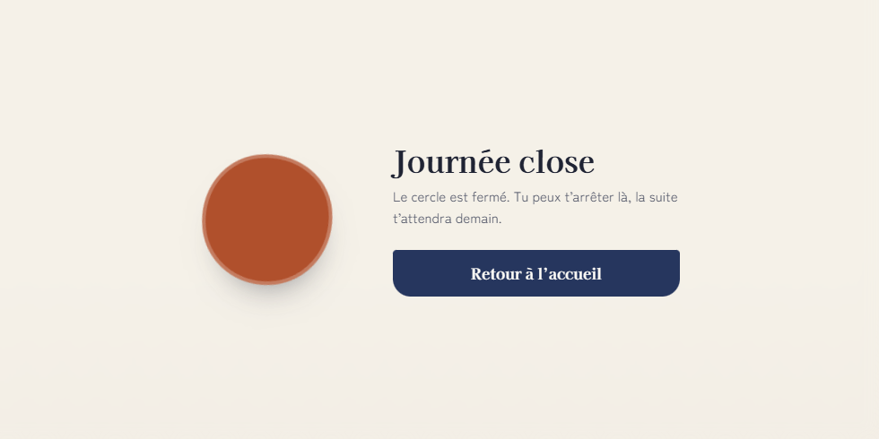

<picture>
  <source media="(prefers-color-scheme: dark)" srcset="docs/banner-nuit.svg">
  
</picture>

<h1 align="center">Constemps</h1>

<p align="center"></p>

<p align="center"><em>Un peu, chaque jour.</em></p>

<p align="center">App web de révision espacée (flashcards, moteur FSRS) qui protège la régularité plutôt que le bachotage, et qui vérifie la compréhension avec une IA, pas seulement la mémoire.</p>

<p align="center">TypeScript · React · NestJS · Prisma · MySQL · Docker · Gemini</p>

## État du projet


Projet en pause depuis octobre 2026. Il n'y a plus de démo en ligne : l'ancien serveur de production a été fermé. Le code est fonctionnel et se lance entièrement en local (voir « Lancer en local » ci-dessous). Pour redéployer un jour sur un nouveau serveur, voir [`DEPLOYMENT.md`](DEPLOYMENT.md).

## Interface


L'interface s'inspire de l'esthétique japonaise : rideaux noren, lanterne qui s'allume au fil de la journée, plaquettes de bois suspendues à une corde, rouleaux, cercles tracés au pinceau. Chaque deck a sa couleur et un symbole à l'encre. Elle est pensée d'abord pour le mobile, passe sur les grands écrans à une colonne de navigation latérale et propose un mode nuit (Jour, Nuit ou Auto, qui suit le système).

<picture>
  <source media="(prefers-color-scheme: dark)" srcset="docs/screenshots/05-accueil-nuit.png">
  
</picture>

<p align="center"><sub>L'accueil, en jour ou en nuit selon le thème de GitHub.</sub></p>

<table>
  <tr>
    <td colspan="2">
      <br>
      <sub>Une question ouverte corrigée par l'IA.</sub>
    </td>
  </tr>
  <tr>
    <td width="50%" valign="top">
      <br>
      <sub>La page d'un deck et ses cartes.</sub>
    </td>
    <td width="50%" valign="top" rowspan="2">
      <br>
      <sub>Sur mobile : l'accueil et une carte en révision.</sub>
    </td>
  </tr>
  <tr>
    <td width="50%" valign="top">
      <br>
      <sub>Le palier du jour atteint : la journée se clôt.</sub>
    </td>
  </tr>
</table>

<p align="center"></p>

<p align="center"><sub>Le cercle qui se ferme, puis l'accueil.</sub></p>

Les captures ont été prises sur un compte de démonstration, avec des données inventées.

### Rythme quotidien

- La journée de l'app va de 4 h à 4 h (heure de Paris), comme le réglage par défaut d'Anki : une session après minuit compte encore pour la veille.
- Chaque deck a son palier du jour. Les révisions dues passent avant les cartes neuves, limitées à 5 par jour et par deck, pour que le travail des jours suivants reste raisonnable.
- Une fois le palier atteint, « Continuer aujourd'hui » ne propose que des révisions, jamais de cartes neuves, jusqu'au double du palier et 20 cartes de plus au maximum.

## Structure du monorepo


```
apps/
  api/   Back NestJS + Prisma + MySQL
  web/   Front React + Vite + TypeScript
package.json         Orchestration racine (concurrently), pas un workspace npm
docker-compose.yml   Service MySQL local
```

`apps/api` et `apps/web` restent deux installations indépendantes (chacune son `node_modules`). Le `package.json` racine ne fait qu'orchestrer leur lancement en une seule commande, voir « Tout lancer en une commande ».

## Lancer en local


Toutes les commandes se lancent depuis la racine du repo, sauf mention contraire.

### 1. Prérequis

- **Node.js** `20.19+` ou `22.12+` (exigence de Vite 8), avec **npm**. Vérifier avec `node --version`.
- **Docker Desktop** (ou Docker Engine avec le plugin `docker compose`, Compose v2 ou plus récent), **démarré** avant de continuer. Vérifier avec `docker info` et `docker compose version`.
- **Git**, pour cloner le repo.

### 2. Démarrer la base MySQL

```bash
docker compose up -d
```

Démarre le service `mysql` de `docker-compose.yml` : MySQL 8.4, base `constemps`, utilisateur `constemps` / mot de passe `constemps` (valeurs de développement local uniquement), exposé sur `localhost:3306`. Les données sont conservées dans un volume Docker nommé `<nom-du-dossier>_mysql_data` (par exemple `constemps_mysql_data` si le repo est cloné dans un dossier `constemps`).

Attention si un MySQL tourne déjà sur ta machine : le conteneur s'appelle toujours `constemps-mysql` (nom fixe) et publie le port `3306`. Si ce port est déjà pris par un autre MySQL, ou si un conteneur `constemps-mysql` existe déjà d'une autre installation, `docker compose up -d` échoue. Arrêter l'autre MySQL (ou supprimer l'ancien conteneur) avant de relancer.

Attendre que MySQL soit prêt avant l'étape 4. `docker compose ps` affiche le service `mysql` en état `running` dès le lancement du conteneur, avant que MySQL accepte les connexions : ce n'est donc pas le bon signal. MySQL est prêt quand `docker compose logs mysql` affiche une ligne `ready for connections` avec `port: 3306` (au premier démarrage, une ligne avec `port: 0` vient d'abord : c'est l'initialisation de la base, pas encore le vrai serveur). Compter quelques secondes, plus au premier démarrage. Si `npx prisma migrate deploy` est lancé trop tôt, il échoue avec `P1017` (« Server has closed the connection ») ou `P1001` : attendre puis relancer la commande.

### 3. Configurer l'API (`apps/api/.env`)

```bash
cp apps/api/.env.example apps/api/.env
```

Puis éditer `apps/api/.env` :

| Variable | Obligatoire | Valeur |
|---|---|---|
| `DATABASE_URL` | oui | Laisser la valeur d'exemple : elle correspond au MySQL de l'étape 2. |
| `JWT_SECRET` | oui | N'importe quelle longue chaîne aléatoire (signe les jetons de session). |
| `GEMINI_API_KEY` | oui | Clé de l'API Gemini, à créer sur [Google AI Studio](https://aistudio.google.com/apikey). |
| `WEB_ORIGIN` | non | URL du front autorisée par CORS. Défaut : `http://localhost:5173`. |
| `PORT` | non | Port de l'API. Défaut : `3000`. |

Sans ces trois variables obligatoires, l'API refuse de démarrer et affiche celles qui manquent.

Pour essayer l'app sans clé Gemini, laisser la valeur d'exemple de `GEMINI_API_KEY` (une variable vide compte comme manquante : l'API refuserait de démarrer). Sans **vraie** clé Gemini (valeur factice), l'API démarre et l'app reste utilisable (comptes, decks, fiches, révisions), mais les fonctionnalités IA ne marchent pas : la traduction et la génération de fiches affichent une erreur, l'évaluation des réponses « Avis assisté » se rabat sur une simple comparaison de mots avec la réponse de référence, et les messages personnalisés du dashboard et des stats sont remplacés par un message générique.

Le front n'a pas besoin de fichier `.env` en local : il appelle l'API sur `http://localhost:3000` par défaut (surchargeable avec `VITE_API_URL`).

### 4. Installer l'API et créer les tables

```bash
cd apps/api
npm install
npx prisma generate
npx prisma migrate deploy
```

`prisma generate` crée le client Prisma à partir du schéma (`npm install` seul ne le fait pas : sans cette commande, l'API ne compile pas, avec des erreurs `Module '"@prisma/client"' has no exported member ...`). `prisma migrate deploy` applique toutes les migrations sur la base de l'étape 2 (sans jamais la réinitialiser).

### 5. Démarrer l'API

Toujours dans `apps/api` :

```bash
npm run start:dev
```

L'API est prête quand le terminal affiche `Nest application successfully started`. Elle répond sur `http://localhost:3000` (`{"status":"ok"}`). Laisser ce terminal ouvert.

### 6. Démarrer le front

Dans un **second** terminal, depuis la racine du repo :

```bash
cd apps/web
npm install
npm run dev
```

### 7. Ouvrir l'app

Ouvrir [http://localhost:5173](http://localhost:5173), puis « Créer un compte » (aucune vérification d'email, le compte est utilisable immédiatement).

## Tout lancer en une commande


Une fois les étapes 1 à 4 faites au moins une fois (et `npm install` lancé dans `apps/web`) :

```bash
npm install   # une seule fois, à la racine (installe concurrently)
npm run dev
```

Cette commande démarre Docker (`docker compose up -d`, sans effet si déjà lancé), puis l'API et le front en parallèle, avec leurs logs préfixés `API`/`WEB` dans le même terminal. `Ctrl+C` arrête l'API et le front (Docker continue de tourner en arrière-plan, comme avec un `docker compose up -d` classique).

## Base de données


Le schéma Prisma se trouve dans `apps/api/prisma/schema.prisma`. Après toute modification du schéma, créer et appliquer une nouvelle migration :

```bash
cd apps/api
npx prisma migrate dev --name <nom_de_la_migration>
```
